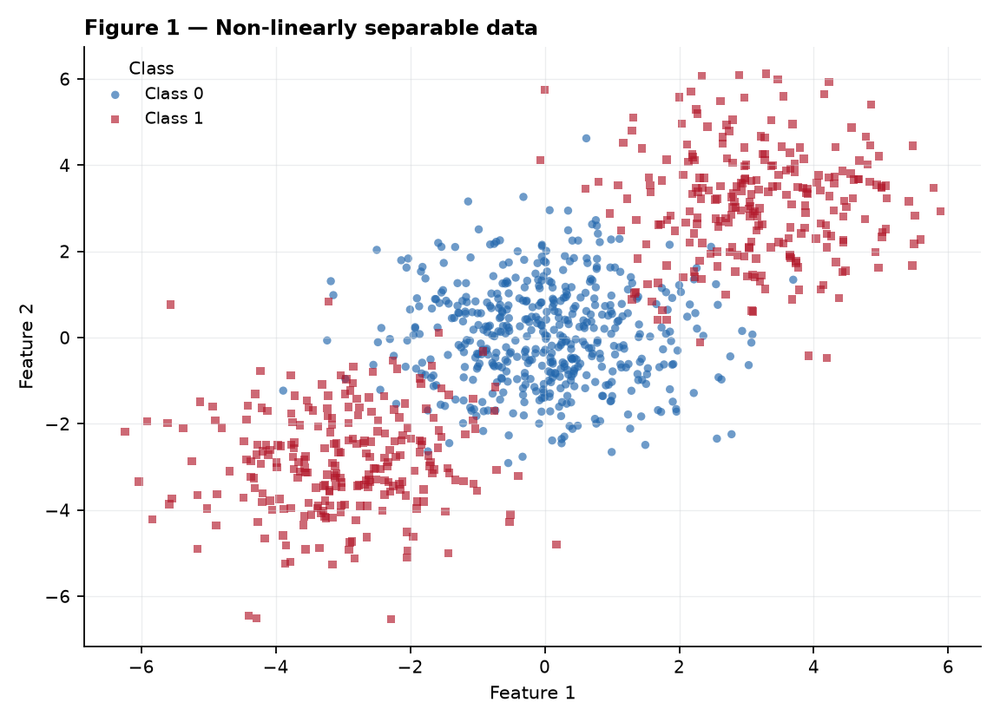
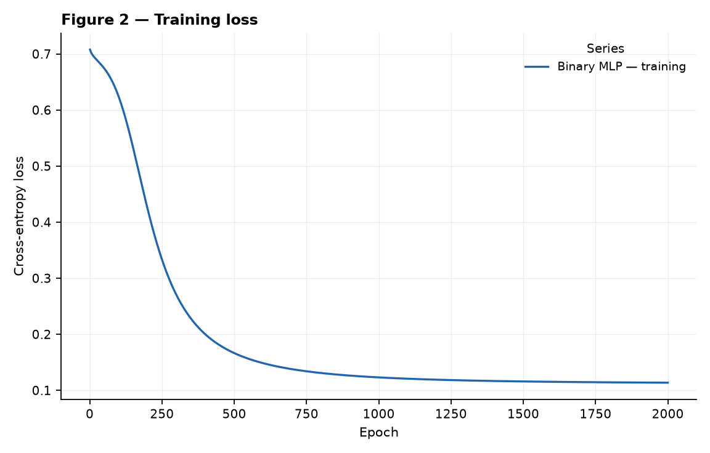
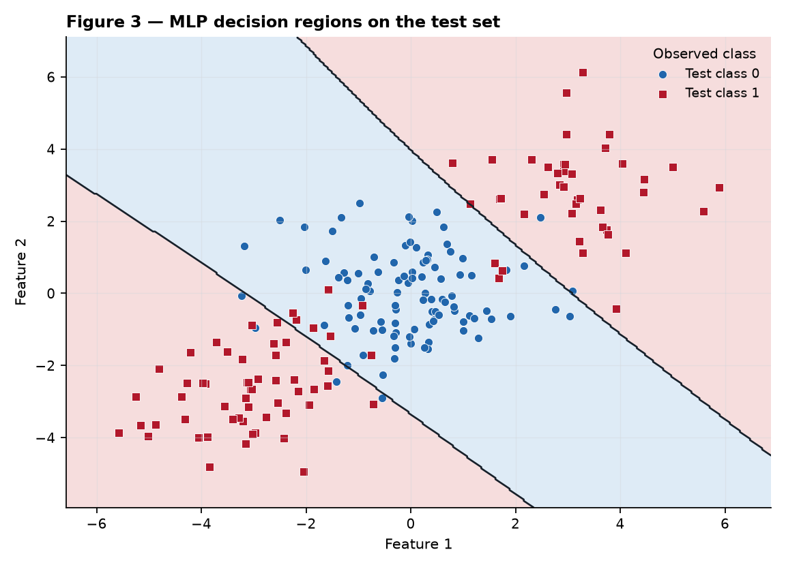
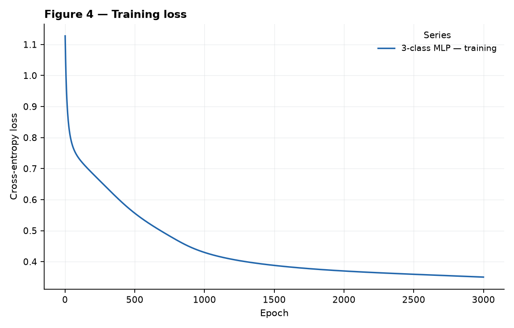
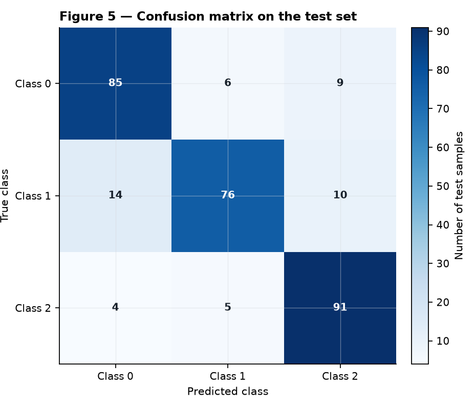
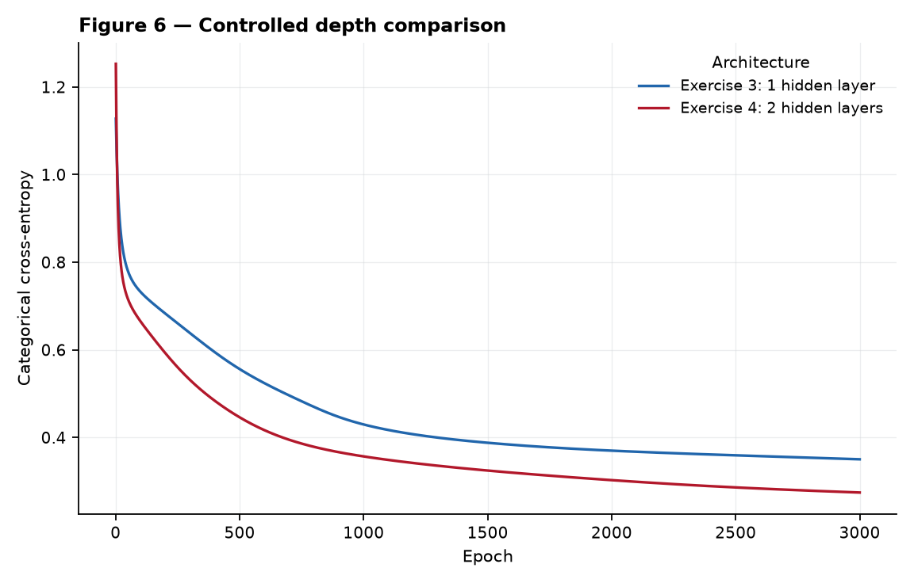

# Activity 3 — Multi-Layer Perceptrons

<p class="eyebrow">Insper · Artificial Neural Networks and Deep Learning · Individual</p>

This report follows one idea from scalar derivatives to a controlled experiment:
a hidden layer can combine linear cuts into a non-linear decision region. I first
carry out one update by hand, then use one hand-written NumPy implementation for
binary and three-class classification, and finally test whether adding a second
hidden layer helps on the same data and training budget.

<div class="kpi">
  <div><span class="k">Binary MLP</span><span class="v">92.00%</span></div>
  <div><span class="k">Linear baseline</span><span class="v">47.50%</span></div>
  <div><span class="k">3-class MLP</span><span class="v">84.00%</span></div>
  <div><span class="k">Deep − shallow mean</span><span class="v">+1.89 pp</span></div>
</div>

!!! info "Reproducibility and allowed tools"
    Dataset generation and both stratified splits use `random_state=42`. Every
    single seeded run uses `np.random.default_rng(seed)`; the main seed is 42.
    The explicit multi-seed requirement in Exercise 4 is the only reason to
    instantiate seeds 7 and 2026 as well, always paired between architectures.
    Feature scaling uses training-set statistics only.
    The MLP itself uses only NumPy: activations, both losses, forward pass,
    gradients, and updates are hand-written. Running
    `python docs/exercises/mlp/code/run_report.py` regenerates Figures 1–6 and
    every number stored in `results/mlp/results.json`.

## Exercise 1 — One step of backpropagation, by hand

### A — Forward pass

For \(\mathbf{x}=[0.5,-0.2]^T\), the two hidden pre-activations are

\[
\begin{aligned}
z^{(1)}_1 &= 0.3(0.5)+(-0.1)(-0.2)+0.1 = \mathbf{0.2700},\\
z^{(1)}_2 &= 0.2(0.5)+0.4(-0.2)-0.2 = \mathbf{-0.1800}.
\end{aligned}
\]

Therefore

\[
\mathbf{h}^{(1)}=\tanh(\mathbf{z}^{(1)})
=[\tanh(0.27),\tanh(-0.18)]
=\mathbf{[0.2636,-0.1781]}.
\]

The output layer gives

\[
\begin{aligned}
u^{(2)}
 &=0.5(0.2636248)+(-0.3)(-0.1780809)+0.2
 =\mathbf{0.3852},\\
\hat y&=\tanh(0.3852367)=\mathbf{0.3672},\\
L&=(1-0.3672466)^2=\mathbf{0.4004}.
\end{aligned}
\]

### B — Backward pass

Starting at the squared loss,

\[
\frac{\partial L}{\partial \hat y}
=2(\hat y-y)=2(0.3672466-1)=\mathbf{-1.2655}.
\]

Since \(d\tanh(u)/du=1-\tanh^2(u)\), the output pre-activation error is

\[
\delta^{(2)}=\frac{\partial L}{\partial u^{(2)}}
=\frac{\partial L}{\partial\hat y}(1-\hat y^2)
=(-1.2655069)(1-0.3672466^2)=\mathbf{-1.0948}.
\]

The output gradients follow directly from
\(u^{(2)}=\mathbf W^{(2)}\mathbf h^{(1)}+b^{(2)}\):

\[
\begin{aligned}
\frac{\partial L}{\partial\mathbf W^{(2)}}
 &=\delta^{(2)}\mathbf h^{(1)}
 =(-1.0948279)[0.2636248,-0.1780809]
 =\mathbf{[-0.2886,0.1950]},\\
\frac{\partial L}{\partial b^{(2)}}&=\delta^{(2)}=\mathbf{-1.0948}.
\end{aligned}
\]

Propagating through the output weights,

\[
\frac{\partial L}{\partial\mathbf h^{(1)}}
=\delta^{(2)}\mathbf W^{(2)}
=(-1.0948279)[0.5,-0.3]
=\mathbf{[-0.5474,0.3284]}.
\]

Applying the hidden `tanh` derivative component by component,

\[
\begin{aligned}
\boldsymbol\delta^{(1)}
=\frac{\partial L}{\partial\mathbf z^{(1)}}
&=\frac{\partial L}{\partial\mathbf h^{(1)}}
  \odot(1-(\mathbf h^{(1)})^2)\\
&=[-0.547414,0.328448]\odot[0.930499,0.968288]\\
&=\mathbf{[-0.5094,0.3180]}.
\end{aligned}
\]

Finally, because
\(\mathbf z^{(1)}=\mathbf W^{(1)}\mathbf x+\mathbf b^{(1)}\),

\[
\begin{aligned}
\frac{\partial L}{\partial\mathbf W^{(1)}}
 &=\boldsymbol\delta^{(1)}\mathbf x^T
 =\begin{bmatrix}-0.509370\\0.318032\end{bmatrix}
   \begin{bmatrix}0.5&-0.2\end{bmatrix}
 =\mathbf{\begin{bmatrix}-0.2547&0.1019\\0.1590&-0.0636\end{bmatrix}},\\
\frac{\partial L}{\partial\mathbf b^{(1)}}
 &=\boldsymbol\delta^{(1)}=\mathbf{[-0.5094,0.3180]}.
\end{aligned}
\]

Thus every weight and bias receives a non-zero gradient.

### C — Parameter update

Using \(\theta\leftarrow\theta-0.3\nabla_\theta L\), the updated parameters are

\[
\begin{aligned}
\mathbf W^{(1)}_{new}
&=\begin{bmatrix}0.3&-0.1\\0.2&0.4\end{bmatrix}
-0.3\begin{bmatrix}-0.2546849&0.1018740\\0.1590162&-0.0636065\end{bmatrix}
=\mathbf{\begin{bmatrix}0.3764&-0.1306\\0.1523&0.4191\end{bmatrix}},\\
\mathbf b^{(1)}_{new}
&=[0.1,-0.2]-0.3[-0.5093698,0.3180324]
=\mathbf{[0.2528,-0.2954]},\\
\mathbf W^{(2)}_{new}
&=[0.5,-0.3]-0.3[-0.2886238,0.1949679]
=\mathbf{[0.5866,-0.3585]},\\
b^{(2)}_{new}
&=0.2-0.3(-1.0948279)=\mathbf{0.5284}.
\end{aligned}
\]

The statement calls these “eight parameters,” but the supplied shapes contain
\(4+2+2+1=9\) scalar parameters; all nine are reported above. A verification
forward pass yields \(\hat y_{new}=0.7112\) and \(L_{new}=0.0834\). The loss
therefore goes **down** from 0.4004 because the update moves in the negative
gradient direction; here the finite step of 0.3 does not overshoot.

## Exercise 2 — Binary classification a straight line cannot do

### A — Generate the data

I used the three centers, sample counts, standard deviation, and seed exactly as
specified. The resulting 1,000 observations contain a central class-0 cluster
and two class-1 clusters on opposite diagonal extremes. The stratified 80/20
split leaves 800 training and 200 test observations.

```python title="Specified data generation and split"
centers = np.array([[0., 0.], [3., 3.], [-3., -3.]])
X, c = make_blobs(n_samples=[500, 250, 250], centers=centers,
                  cluster_std=1.2, random_state=42)
y = (c > 0).astype(int)
X_train, X_test, y_train, y_test = train_test_split(
    X, y, test_size=0.2, random_state=42, stratify=y)
```

<figure markdown="span">
  
  <figcaption>Figure 1 — The complete binary dataset. Colour and marker shape redundantly identify class.</figcaption>
</figure>

### B — Establish the baseline

Logistic regression obtains **47.50% test accuracy** (95/200). Its single
boundary divides the plane into two half-planes, so selecting either outer
class-1 cluster necessarily leaves the other on the class-0 side; rotating the
line to include both also captures much of the central class-0 cluster.

### C — Implement the MLP

The reusable architecture is **2–8–1**: two standardized inputs, eight `tanh`
hidden units, and one sigmoid output. I use full-batch gradient descent with
binary cross-entropy, learning rate **0.1**, and **2,000 epochs**. The complete
hand-written class is shown below. Exercises 3 and 4 call the exact same
`forward`, `backward`, `update`, and `fit` methods unchanged.

```python title="code/mlp.py — shared NumPy implementation"
--8<-- "docs/exercises/mlp/code/mlp.py"
```

On the held-out set the MLP correctly classifies 184/200 observations, for
**92.00% test accuracy**. Its final training loss is **0.113632**.

<figure markdown="span">
  
  <figcaption>Figure 2 — Binary cross-entropy decreases from initialization to 0.113632.</figcaption>
</figure>

<figure markdown="span">
  
  <figcaption>Figure 3 — Decision regions evaluated on a dense grid, with only held-out observations overlaid.</figcaption>
</figure>

### D — Analysis

Figure 3 shows the essential geometric difference: the MLP assigns class 1 to
two outer lobes, one in the lower-left and one in the upper-right, while keeping
a class-0 band around the origin. Hidden units form several linear cuts and
`tanh` combines them into this non-convex, effectively disconnected rule. A
logistic model has only one cut and one class-1 half-plane. It cannot put two
opposite clusters in that half-plane while excluding the cluster between them;
that structural mismatch explains **47.50% versus 92.00%**, rather than merely
saying that the data are “non-linear.”

## Exercise 3 — Multi-class, same network

### A — Generate the data

I used `make_classification` exactly as specified: 1,500 samples, four
informative features, three classes, two clusters per class, `class_sep=1.0`,
and `random_state=42`. The stratified 80/20 split contains 1,200 training and
300 test observations. Standardization is fitted on the training partition and
then applied to both partitions.

### B — Adapt the network

Only arguments and output behavior change: architecture **4–12–3**, softmax,
and categorical cross-entropy. The shared model core remains untouched.
For logits \(\mathbf u\), probabilities
\(p_j=e^{u_j}/\sum_r e^{u_r}\), and a one-hot target \(\mathbf y\),

\[
L=-\sum_j y_j\log p_j,
\qquad
\frac{\partial p_j}{\partial u_k}=p_j(\mathbb 1[j=k]-p_k).
\]

Therefore

\[
\begin{aligned}
\frac{\partial L}{\partial u_k}
&=-\sum_j\frac{y_j}{p_j}\frac{\partial p_j}{\partial u_k}\\
&=-\sum_j y_j(\mathbb 1[j=k]-p_k)\\
&=-y_k+p_k\sum_jy_j
=\boxed{p_k-y_k},
\end{aligned}
\]

because a one-hot target sums to one. The batch implementation divides this
quantity by \(N\), so the matrix error entering backpropagation is
\((\mathbf P-\mathbf Y)/N\). This is the same output-error form used by
sigmoid plus binary cross-entropy.

### C — Train and evaluate

With learning rate **0.1** and **3,000 full-batch epochs**, the seed-42 run
reaches **84.00% test accuracy** (252/300) and final training loss **0.350290**.
The model has 99 trainable scalar parameters.

<figure markdown="span">
  
  <figcaption>Figure 4 — Training loss for the 4–12–3 network.</figcaption>
</figure>

<figure markdown="span">
  
  <figcaption>Figure 5 — Held-out confusion matrix; rows are true classes and columns are predictions.</figcaption>
</figure>

### D — Analysis

The confusion matrix is

\[
\begin{bmatrix}85&6&9\\14&76&10\\4&5&91\end{bmatrix}.
\]

Counting mistakes in both directions, classes **0 and 1** are the most-confused
pair: \(6+14=20\), versus 13 for 0/2 and 15 for 1/2. Each label is a union of
two clusters in a four-dimensional space, so the six clusters can overlap in
some feature directions and a class need not occupy one convex region. The
asymmetry (14 class-1 points called 0, but 6 in the reverse direction) also
shows that the overlap and learned regions are not balanced. Multinomial
logistic regression reaches **66.33%**; the hidden layer adds twelve learned
non-linear features that can combine multiple cuts around the two clusters per
class, raising the result to **84.00%**.

## Exercise 4 — Does a second hidden layer help?

### A — Train the deeper network

The deeper model is **4–12–12–3**. Relative to Exercise 3, only the additional
12-unit hidden layer changes: data, split, preprocessing, learning rate 0.1,
3,000-epoch budget, activation, loss, and seed are held fixed. At seed 42 it
has 255 parameters, final training loss **0.274437**, and **87.33% test
accuracy** (262/300).

### B — Compare

<figure markdown="span">
  
  <figcaption>Figure 6 — Controlled comparison at seed 42. The deeper model fits the training set more closely.</figcaption>
</figure>

--8<-- "results/mlp/tbl_depth_comparison.md"

To compare models rather than one lucky initialization, I repeated both with
the same three paired seeds:

--8<-- "results/mlp/tbl_seed_trials.md"

The shallow mean is **84.44%** and the deep mean is **86.33%**. Thus the
measured deep-minus-shallow difference is **+1.89 percentage points**.

### C — Analysis

In these runs the second hidden layer **does help modestly**, although the
statement warns that the opposite is common and would also be valid. The loss
and accuracy tell a consistent story: at seed 42 the deeper network ends with
lower training loss (0.274437 versus 0.350290) and higher test accuracy (87.33%
versus 84.00%); the advantage also has the same sign in all three seed pairs.

This is still a small tabular problem with only six generating clusters. One
hidden layer already has enough capacity to draw the required regions, so the
extra 156 parameters buy only 1.89 points on average—not a qualitative leap.
The second layer can recombine first-layer cuts into more economical
higher-order regions, but it also adds non-convex optimization work and greater
variance. Three seeds establish the requested comparison, not a general claim
that depth always wins. Extra depth should pay off more reliably on data with
hierarchical or compositional structure—for example images where edges combine
into textures, parts, and objects—or on functions that require repeatedly
reusing intermediate features.

The [full code listing](code.md) and the executed notebook contain the same
implementation and experiments. AI collaboration is disclosed in the page
metadata, as required; all calculations and conclusions were checked against
the machine-readable seeded output.

## Results summary

| # | Quantity | Value |
|---|---|---|
| 1 | Ex. 1 — \(\mathbf z^{(1)}\) and \(\mathbf h^{(1)}\) | \([0.2700,-0.1800]\); \([0.2636,-0.1781]\) |
| 2 | Ex. 1 — \(u^{(2)}\), \(\hat y\), and \(L\) | 0.3852; 0.3672; 0.4004 |
| 3 | Ex. 1 — all updated parameters | \(\mathbf W^{(1)}=[[0.3764,-0.1306],[0.1523,0.4191]]\); \(\mathbf b^{(1)}=[0.2528,-0.2954]\); \(\mathbf W^{(2)}=[0.5866,-0.3585]\); \(b^{(2)}=0.5284\) |
| 4 | Ex. 2 — linear baseline test accuracy | 47.50% |
| 5 | Ex. 2 — architecture and test accuracy | 2–8–1; 92.00% |
| 6 | Ex. 3 — architecture and test accuracy | 4–12–3; 84.00% |
| 7 | Ex. 3 — most-confused class pair | Classes 0 and 1; 20 bidirectional errors |
| 8 | Ex. 4 — architecture and test accuracy | 4–12–12–3; 87.33% at seed 42 |
| 9 | Ex. 4 — accuracy difference against Ex. 3 | +1.89 percentage points, mean over seeds 7, 42, 2026 |
